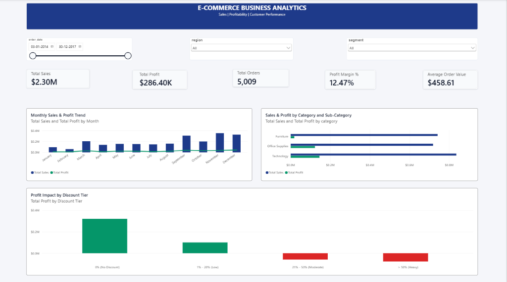

# 📊 E-Commerce Sales, Pricing & Profitability Analysis

[](https://www.python.org/)
[](https://pandas.pydata.org/)
[](https://www.postgresql.org/)
[](https://powerbi.microsoft.com/)
[](https://opensource.org/licenses/MIT)

An end-to-end business intelligence and data engineering project investigating revenue growth, pricing elasticity, promotional discount erosion, and fulfillment efficiency across 9,994 transactional records.

---

## 🖥️ Executive Business Dashboard



The interactive **Microsoft Power BI Dashboard** (`dashboard/ecommerce_analytics_dashboard.pbix`) connects directly to **PostgreSQL 18** in **Import mode**, delivering executive visibility across top-level financial health, product category profitability, seasonal demand spikes, and discount impact.

---

## 📌 Executive Summary & Key Business Findings

Reconciled with 100% precision across Python, PostgreSQL 18, and Power BI:

| Business Metric | Value | Executive Finding & Business Context |
| :--- | :---: | :--- |
| **Total Gross Revenue** | **$2,297,200.65** | Generated across 5,009 distinct orders and 793 unique customers. |
| **Total Net Profit** | **$286,396.54** | Net profitability across all operations (**12.47% overall profit margin**). |
| **Total Orders** | **5,009** | Order transactions spanning 9,994 distinct line items. |
| **Average Order Value (AOV)** | **$458.61** | Healthy order basket size across Consumer, Corporate, and Home Office tiers. |
| **Average Fulfillment Speed** | **4.0 Days** | Uniform fulfillment duration across all four geographic regions. |

---

## 🔍 In-Depth Analytical Insights

### 1. The 20% Discount Cliff (Pricing Danger Zone)
* **0% Discount (Full Price):** Generates **$320,987.01 in profit** with an exceptional **29.50% profit margin**.
* **1% – 20% Discount (Conservative Promotions):** Generates **$100,785.81 in profit** with a healthy **11.91% profit margin**.
* **21% – 50% Discount (Deep Margin Erosion):** Turns immediately negative, generating a net loss of **-$58,817.15** (**-19.70% margin**).
* **> 50% Heavy Discount (Severe Capital Destruction):** Produces a catastrophic net loss of **-$76,559.13** (**-119.20% margin**).
* **Strategic Recommendation:** Cap standard sales promotions at **20% max discount**. Establish strict VP approval requirements for any discount exceeding 20%, as deeper cuts actively destroy profit rather than stimulate profitable demand.

### 2. The "Furniture Illusion" (High Volume, Low Margin)
* **Technology:** **$836.2k Revenue** | **$145.5k Profit** | **17.40% Margin** (Star performer).
* **Office Supplies:** **$719.0k Revenue** | **$122.5k Profit** | **17.04% Margin** (Consistent volume driver).
* **Furniture:** **$742.0k Revenue** | **$18.5k Profit** | **2.49% Margin** (Severe margin squeeze).
* **Root Cause:** The **Tables** sub-category within Furniture operates at a net loss (**-$17,725.48** total loss) due to high freight costs and aggressive manufacturer discounting (e.g., Chromcraft conference tables losing up to -29% margin).

### 3. Q4 Seasonality & Demand Surges
* Revenue peaks consistently in **November and December** (surpassing $118k+ monthly volume with **+52.3% MoM growth** in November), reflecting Black Friday promotions and corporate fiscal year-end budget flushing.

### 4. Regional Profit Disparities
* **West Region:** Top performer generating **$108,418.31 profit** (**14.94% margin**).
* **East Region:** Strong performance generating **$91,522.50 profit** (**13.48% margin**).
* **South Region:** Steady performance generating **$46,749.49 profit** (**11.93% margin**).
* **Central Region:** Lags significantly at **$39,706.24 profit** (**7.92% margin**), driven by excessive discounting in states like Texas and Illinois.

---

## 🛠️ Technology Stack & Architecture

```text
       ┌────────────────────────┐
       │     RAW DATA INGEST    │
       │  Sample-Superstore.csv │
       └───────────┬────────────┘
                   │
                   ▼
       ┌────────────────────────┐
       │   PYTHON ETL PIPELINE  │
       │  02_clean_data.py      │ ──► Pandas, NumPy (Date casting, ZIP padding,
       └───────────┬────────────┘      Quality validations, Snake_case conversion)
                   │
                   ▼
       ┌────────────────────────┐
       │   POSTGRESQL 18 RDBMS  │
       │  03_load_to_postgres   │ ──► Relational Schema, Primary Keys, Indexes,
       │  ecommerce_analytics   │      9,994 verified transactional rows
       └───────────┬────────────┘
                   │
                   ├──────────────────────────────┐
                   ▼                              ▼
       ┌────────────────────────┐    ┌────────────────────────┐
       │  SQL BUSINESS METRICS  │    │  MICROSOFT POWER BI    │
       │  02_analysis.sql       │    │  Import Mode (5433)    │
       │  (7 Analytical Queries)│    │  DAX Measures & Theme  │
       └────────────────────────┘    └────────────────────────┘
```

| Technology | Implementation in this Project |
| :--- | :--- |
| **Python 3.13** | Core orchestration language for automated data extraction and transformation pipelines. |
| **Pandas** | Ingestion of raw Windows-1252 data, standardization to `snake_case`, missing/duplicate checks, feature enrichment (`shipping_duration_days`). |
| **NumPy** | Vectorized numeric operations, date arithmetic, and data integrity safeguards. |
| **PostgreSQL 18** | Relational database hosting `superstore_orders` and normalized dimension tables (`customers`, `locations`, `products`). |
| **SQL** | 7 Advanced analytical queries utilizing CTEs, Window Functions (`LAG()`, `OVER()`), and Conditional Binning (`CASE WHEN`). |
| **Microsoft Power BI** | Executive presentation layer featuring DAX measures, dynamic multi-slicers, and custom corporate UI theme. |

---

## 📁 Repository Directory Structure

```text
E-commerce-Sales-Pricing-Profitability-Analysis/
│
├── dashboard/                              # Power BI Assets & Documentation
│   ├── dashboard_preview.png               # High-resolution dashboard screenshot
│   ├── ecommerce_analytics_dashboard.pbix  # Production Power BI Dashboard file
│   ├── DAX_Measures.dax                    # Formatted DAX measures & calculated columns
│   ├── Executive_Theme.json                # Custom executive visual palette
│   └── PowerBI_Setup_Guide.md              # Detailed Power BI build instructions
│
├── data/
│   ├── raw/                                # Pristine, untouched source datasets
│   └── processed/                          # Cleaned, standardized CSV outputs
│
├── src/                                    # Reproducible Python ETL Scripts
│   ├── 02_clean_data.py                    # Data cleaning & standardization script
│   └── 03_load_to_postgres.py             # Automated PostgreSQL schema creation & loader
│
├── sql/                                    # SQL Data Architecture & Analysis
│   ├── 01_schema.sql                       # Database schema, table definitions & indexes
│   └── 02_analysis.sql                     # 7 Strategic business analytics SQL queries
│
├── .env.example                            # Configuration template for database credentials
├── .gitignore                              # Git exclusion rules (venv, secrets, raw data)
├── requirements.txt                        # Python library dependencies
└── README.md                               # Comprehensive project documentation
```

---

## 🧮 DAX Measures Formulation

All measures were validated against live PostgreSQL query benchmarks:

```dax
// 1. Total Gross Revenue
Total Sales = SUM(superstore_orders[sales])

// 2. Total Net Profit
Total Profit = SUM(superstore_orders[profit])

// 3. Profit Margin Percentage
Profit Margin % = DIVIDE([Total Profit], [Total Sales], 0)

// 4. Distinct Order Volume
Total Orders = DISTINCTCOUNT(superstore_orders[order_id])

// 5. Average Order Value (AOV)
Average Order Value = DIVIDE([Total Sales], [Total Orders], 0)

// 6. Discount Tier Calculated Column
Discount Tier = 
SWITCH(
    TRUE(),
    superstore_orders[discount] = 0, "0% (No Discount)",
    superstore_orders[discount] <= 0.20, "1% - 20% (Low)",
    superstore_orders[discount] <= 0.50, "21% - 50% (Moderate)",
    "> 50% (Heavy)"
)
```

---

## 🚀 How to Replicate Locally

### 1. Clone the Repository
```bash
git clone https://github.com/maniishh/E-commerce-Sales-Pricing-Profitability-Analysis.git
cd E-commerce-Sales-Pricing-Profitability-Analysis
```

### 2. Set Up Virtual Environment & Dependencies
```powershell
# Create virtual environment
python -m venv .venv

# Activate on Windows PowerShell
.\.venv\Scripts\Activate.ps1

# Install required packages
pip install -r requirements.txt
```

### 3. Run Data Cleaning Pipeline
```bash
python src/02_clean_data.py
```

### 4. Configure Database Credentials & Load to PostgreSQL
1. Copy `.env.example` to `.env`:
   ```bash
   cp .env.example .env
   ```
2. Update `.env` with your PostgreSQL port (e.g., `5433`) and password.
3. Run the automated database loader:
   ```bash
   python src/03_load_to_postgres.py
   ```

### 5. Open & Explore the Power BI Dashboard
1. Open `dashboard/ecommerce_analytics_dashboard.pbix` in **Microsoft Power BI Desktop**.
2. Click **Refresh** to stream data directly from your local PostgreSQL database.

---

## 📜 License
This project is open-source under the [MIT License](LICENSE).
